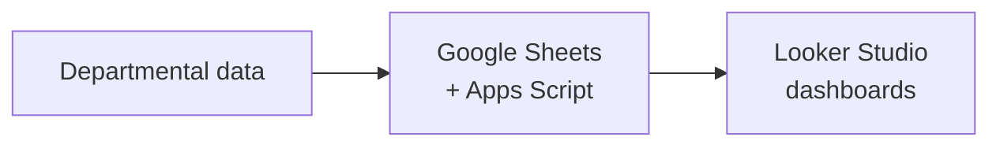
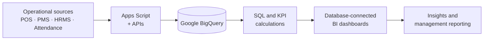

 

**Hyderabad, India** &nbsp;|&nbsp; Data Analyst at Skyla Hospitality

 

 

## About

I joined Skyla Hospitality as one of its first dedicated Data Analysts, in an organization with no analytics function, KPI framework or consistent reporting. With a senior colleague I helped build that foundation, then took ownership of analytics delivery, moved reporting from spreadsheets to a **BigQuery** warehouse with automated ingestion, and built the database-connected dashboards and internal applications that make reliable reporting possible.

**I progressed from building reports to building the data systems and business applications behind them.**

---

## Skills and How I Use Them

| Area | Tools and methods | What I use them for |
| :-- | :-- | :-- |
| **SQL and analytics** | SQL, joins and aggregations, subqueries, window functions, KPI design and calculation, data validation, trend analysis | Turning raw records into trustworthy KPIs |
| **Data warehousing** | Google BigQuery, reporting data models, analytical queries, source-to-warehouse workflows | One reliable reporting layer for every department |
| **Data automation** | Google Apps Script, API integration, automated ingestion, full-refresh and incremental loading | Replacing manual data handling |
| **Business intelligence** | Database-connected dashboards, interactive dashboard applications, KPI and executive reporting, Looker Studio | Management visibility and performance monitoring |
| **Application development** | Claude Code, Lovable, GitHub, Vercel, Progressive Web Apps | AI-assisted development of operational tools. They support my analysis; they do not replace it |
| **Supporting** | Excel, Google Cloud Platform | Analysis and hosting |

Currently developing: Power BI. Currently learning: Python.

---

## My Journey at Skyla Hospitality

| 01 · Foundation | 02 · Ownership | 03 · Transformation | 04 · Intelligence |
| :-: | :-: | :-: | :-: |
| Jul to Dec 2025 | Dec 2025 to Apr 2026 | Apr to Oct 2026 | Oct 2026 to now |
| KPI frameworks and the first dashboards | Independent delivery and intern training | BigQuery, automated ingestion, connected dashboards | ERP applications and standardized processes |

<table>
  <tr>
    <td width="80" align="center" valign="top"><h1>01</h1></td>
    <td valign="top">
      <h3>Building the analytics foundation &nbsp;Jul to Dec 2025</h3>
      <b>Problem:</b> no dedicated analytics function, structured KPI framework or consistent departmental reporting. 
      <b>Contribution:</b> as one of the first two analysts, I worked with a senior Data Analyst, and under their guidance, to identify data sources, gather and organize operational data, define reporting requirements, establish initial KPI frameworks and set up regular reporting. 
      <b>Systems:</b> Google Sheets, Looker Studio, Apps Script. 
      <b>Outcome:</b> four departmental dashboards completed together: F&B, Sales, Engineering and Housekeeping. The senior analyst then left, which led to the next stage.
    </td>
  </tr>
  <tr>
    <td width="80" align="center" valign="top"><h1>02</h1></td>
    <td valign="top">
      <h3>Independent ownership &nbsp;Dec 2025 to Apr 2026</h3>
      <b>Problem:</b> analytics delivery needed an owner. 
      <b>Contribution:</b> management entrusted me with continuing the work. I trained an intern and independently completed eight dashboards: HR, Finance, Branding & Marketing, Learning & Development, Attendance, Front Office, Procurement and Central Store. I also kept the original four running, with my manager's guidance. 
      <b>Systems:</b> Google Sheets, Looker Studio, Apps Script. 
      <b>Outcome:</b> growth from working under a senior analyst to owning delivery. As data grew, spreadsheets and some dashboards became slow and hard to open reliably.
    </td>
  </tr>
  <tr>
    <td width="80" align="center" valign="top"><h1>03</h1></td>
    <td valign="top">
      <h3>Warehousing, automation and modern BI &nbsp;Apr to Oct 2026</h3>
      <b>Problem:</b> the reporting architecture could not scale. 
      <b>Contribution:</b> with outside guidance from an experienced analytics professional, I learned the concepts and built a centralized BigQuery warehouse, first loading data manually, then automating source-to-warehouse ingestion with Apps Script and APIs for F&B POS, Sales PMS, HRMS and attendance data, using full-refresh and incremental loading. I then moved beyond Looker Studio to database-connected dashboard applications built with Claude and Lovable on BigQuery and SQL. I worked in a two-person team and carried substantial individual implementation. 
      <b>Also:</b> built F&B costing reports from recipe and menu data for F&B, procurement, central store and management, and developed the F&B application (below). 
      <b>Outcome:</b> reporting that is automated, centralized and database-connected.
    </td>
  </tr>
  <tr>
    <td width="80" align="center" valign="top"><h1>04</h1></td>
    <td valign="top">
      <h3>Operational systems and process standardization &nbsp;Oct 2026 to now</h3>
      <b>Problem:</b> the roughly 13 Google Forms I had introduced for Housekeeping tracking grew unwieldy, and staff were unsure which form to use. 
      <b>Contribution:</b> developed a consolidated Housekeeping ERP, now deployed across six properties. 
      <b>Direction (in progress, not completed):</b> business insights, automated alerts, exception monitoring, market analysis and more proactive decision support.
    </td>
  </tr>
</table>

---

## Reporting Architecture: Then and Now

**Earlier phase (Stages 01 and 02)**

**Current phase (Stages 03 and 04)**

Loading uses full refresh or incremental loading, in scheduled batches rather than real-time streaming. The dashboards are built with AI-assisted development. They do not include AI-generated insights or predictive models.

---

## Highlights

- Helped establish the analytics and reporting foundation at Skyla Hospitality
- Co-delivered the first four departmental dashboards, then independently delivered eight more and trained an intern
- Built a BigQuery reporting warehouse and automated ingestion workflows
- Moved from spreadsheet reporting toward database-connected dashboard applications
- Developed two internal applications used across six properties (below)
- Helped standardize departmental data collection and operational reporting

---

## Business Applications and Operational Transformation

Internal applications developed at work. They are private, so no links or screenshots are shown.

<table>
  <tr>
    <td width="50%" valign="top">
      <h3>F&B Costing, Consumption and Wastage</h3>
      <b>Problem:</b> kitchen teams had no easy way to record consumption and wastage, and many were not comfortable with Excel.  
      <b>Solution:</b> a practical application for kitchen teams, so I built a usable tool, not another dashboard.  
      <b>Reach:</b> six properties, 30+ team members.
    </td>
    <td width="50%" valign="top">
      <h3>Housekeeping ERP</h3>
      <b>Problem:</b> fragmented tracking across about 13 forms.  
      <b>Solution:</b> one standardized system for Housekeeping teams.  
      <b>Reach:</b> six properties. Replacing a paid housekeeping audit tool for that functionality is estimated to have avoided about ₹1.8 lakh in subscription costs. It does not replace every capability of that product.
    </td>
  </tr>
</table>

Both were developed with Claude Code and deployed through GitHub and Vercel as installable Progressive Web Apps.

---

## Featured Public BI Projects

Public portfolio demonstrations, separate from the internal applications above. They use demonstration or sanitized data.

<table>
  <tr>
    <td width="50%" valign="top">
      <h3>Sales & Revenue Intelligence</h3>
      Revenue vs target, occupancy, ADR, RevPAR, bookings, leads and OTA performance.  
      <a href="https://github.com/Nandini-Boda/Hospitality-Sales-Revenue-Intelligence-Platform">Repository</a>
    </td>
    <td width="50%" valign="top">
      <h3>Weekly Insight Hub</h3>
      Weekly management reporting across Revenue, Brand, People, Property and an Executive Review.  
      <a href="https://github.com/Nandini-Boda/hospitality-weekly-insight-hub">Repository</a>
    </td>
  </tr>
  <tr>
    <td width="50%" valign="top">
      <h3>Brand Experience HQ</h3>
      Guest review analytics on fictional demo data, with no live review-platform integration.  
      <a href="https://github.com/Nandini-Boda/Brand-Experience-HQ">Repository</a> &nbsp;·&nbsp; <a href="https://stay-sentiment-compass.lovable.app/">Live demo</a>
    </td>
    <td width="50%" valign="top">
      <h3>Workforce Attendance Intelligence</h3>
      Attendance rate, department comparison and employee drill-down. BigQuery data with scheduled batch sync, not real-time.  
      <a href="https://github.com/Nandini-Boda/Workforce-Attendance-Intelligence-Dashboard">Repository</a> &nbsp;·&nbsp; <a href="https://hr-attendance-dashboard.lovable.app">Live demo</a>
    </td>
  </tr>
</table>

**SQL practice:** &nbsp;[Orders & Customers Analysis](https://github.com/Nandini-Boda/SQL-Orders-Customers-Analysis) &nbsp;·&nbsp; [Bank Loan Analysis](https://github.com/Nandini-Boda/BANK-LOAN-ANALYSIS) &nbsp;·&nbsp; [Online Sales Data](https://github.com/Nandini-Boda/SQL-ONLINE-SALES-DATA)

---

## Education and Training

- **B.Tech, Electronics and Communication Engineering**, RGUKT Basara, 2021 to 2025 (CGPA 8.0)
- **Data Analysis, Power BI, SQL and Excel**, United Way Hyderabad, 2025
- **Microsoft Techsaksham**, 2024
- **Data Analyst Intern**, Elevate Labs, June to July 2025 (Best Performer)

---

*Building the bridge between operational data, automated systems and business intelligence.*

**Open to Data Analyst and BI Analyst roles** &nbsp;·&nbsp; [LinkedIn](https://www.linkedin.com/in/nandini-boda-24414a367/) &nbsp;·&nbsp; [Portfolio](https://boda-nandini-portfolio.lovable.app/)

