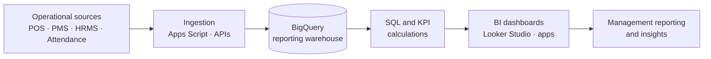

 

**Hyderabad, India** &nbsp;|&nbsp; Data Analyst at Skyla Hospitality

 

 

## About

I work with a hospitality group's operational data and turn it into KPIs, dashboards and management reports. My day-to-day is SQL on a **Google BigQuery** reporting warehouse, **Looker Studio** and dashboard development, and **Google Apps Script** and API ingestion that keeps reports current. I started on dashboards alongside a senior colleague, then took responsibility for further reporting and automation work, and I also build internal business applications.

---

## Skills

| Area | Tools and methods | What I use them for |
| :-- | :-- | :-- |
| **SQL and analytics** | SQL, joins and aggregations, subqueries, window functions, KPI calculations, data validation, trend analysis | Turning raw records into KPIs and checking that the numbers hold up |
| **Data warehousing** | Google BigQuery, reporting data models, analytical SQL | Warehouse-backed reporting that every dashboard reads from |
| **Business intelligence** | Looker Studio, interactive dashboards, executive reporting, performance monitoring | Giving managers one consistent view of performance |
| **Data automation** | Google Apps Script, API integration, automated ingestion, full-refresh and incremental loading | Moving data from operational systems into the warehouse without manual work |
| **Supporting tools** | Google Cloud Platform, GitHub, Lovable, Vercel, Excel | Hosting, version control, dashboard apps and quick analysis |

Currently developing: Power BI. Currently learning: Python.

---

## Featured Analytics Projects

Public portfolio demonstrations using demonstration or sanitized data. They do not show real company performance.

<table>
  <tr>
    <td width="50%" valign="top">
      <h3>Sales & Revenue Intelligence</h3>
      <b>Question:</b> How are properties performing commercially against target?  
      Revenue vs target, occupancy, ADR, RevPAR, bookings and room nights, lead tracking, OTA performance and report exports.  
      <a href="https://github.com/Nandini-Boda/Hospitality-Sales-Revenue-Intelligence-Platform">Repository</a>
    </td>
    <td width="50%" valign="top">
      <h3>Weekly Insight Hub</h3>
      <b>Question:</b> What should management review this week?  
      Weekly reporting across Revenue, Brand, People, Property and an Executive Review, built on BigQuery reporting demo tables.  
      <a href="https://github.com/Nandini-Boda/hospitality-weekly-insight-hub">Repository</a>
    </td>
  </tr>
  <tr>
    <td width="50%" valign="top">
      <h3>Brand Experience HQ</h3>
      <b>Question:</b> What are guests saying across brands and properties?  
      Review volume and average rating, positive and negative reviews, sentiment trends, property comparison, recurring themes, staff recognition and review-linked action tracking. <i>Fictional demo data; no live review-platform integrations.</i>  
      <a href="https://github.com/Nandini-Boda/Brand-Experience-HQ">Repository</a> &nbsp;·&nbsp; <a href="https://stay-sentiment-compass.lovable.app/">Live demo</a>
    </td>
    <td width="50%" valign="top">
      <h3>Workforce Attendance Intelligence</h3>
      <b>Question:</b> How is attendance trending, and where should HR look closer?  
      Attendance rate, present, absent and leave analysis, department comparison, working hours, trends and employee drill-down with a monthly calendar. BigQuery data, scheduled batch sync (not real-time).  
      <a href="https://github.com/Nandini-Boda/Workforce-Attendance-Intelligence-Dashboard">Repository</a> &nbsp;·&nbsp; <a href="https://hr-attendance-dashboard.lovable.app">Live demo</a>
    </td>
  </tr>
</table>

---

## How My Reporting Workflow Runs

Data is loaded by **full refresh** or **incremental loading**, depending on the source. No company infrastructure details are published here.

---

## Experience

**Data Analyst, Skyla Hospitality** &nbsp;|&nbsp; July 2025 to present

Reporting across Sales, F&B, Engineering, Housekeeping, HR, Finance, Branding, Attendance, Front Office, Procurement, Central Store and Learning & Development.

- Dashboard development and management reporting, starting with a senior colleague and then taking on further reporting and automation
- SQL-based reporting on BigQuery, KPI design, data validation and cross-functional requirements
- Source-to-warehouse ingestion automation with Apps Script and APIs
- Helped train an intern

**Internal business applications**

- **F&B Costing, Consumption and Wastage:** used across six properties by 30+ team members
- **Housekeeping ERP:** contributed to an internal application used across six properties

**Data Analyst Intern, Elevate Labs** &nbsp;|&nbsp; June 2025 to July 2025
Best Performer recognition.

---

## SQL Practice

Older practice projects, kept as supporting work.

| Project | Demonstrates |
| :-- | :-- |
| [Orders & Customers Analysis](https://github.com/Nandini-Boda/SQL-Orders-Customers-Analysis) | Joins, HAVING, a subquery, a window function and a view |
| [Bank Loan Analysis](https://github.com/Nandini-Boda/BANK-LOAN-ANALYSIS) | Month-to-date vs prior-month-to-date KPI queries |
| [Online Sales Data](https://github.com/Nandini-Boda/SQL-ONLINE-SALES-DATA) | Monthly revenue and order analysis with date functions |

---

## Education and Training

- **B.Tech, Electronics and Communication Engineering**, RGUKT Basara, 2021 to 2025 (CGPA 8.0)
- **Data Analysis, Power BI, SQL and Excel**, United Way Hyderabad, 2025
- **Microsoft Techsaksham**, 2024

---

<!--
  OPTIONAL: GitHub stats card. Left out on purpose, because activity stats are not a professional achievement
  and the card depends on a third-party service that is sometimes unavailable.
  To add it, remove these comment markers:

  

-->

*"Without data, you're just another person with an opinion." (W. Edwards Deming, attributed)*

**Open to Data Analyst and BI Analyst roles** &nbsp;·&nbsp; [LinkedIn](https://www.linkedin.com/in/nandini-boda-24414a367/) &nbsp;·&nbsp; [Portfolio](https://boda-nandini-portfolio.lovable.app/)

