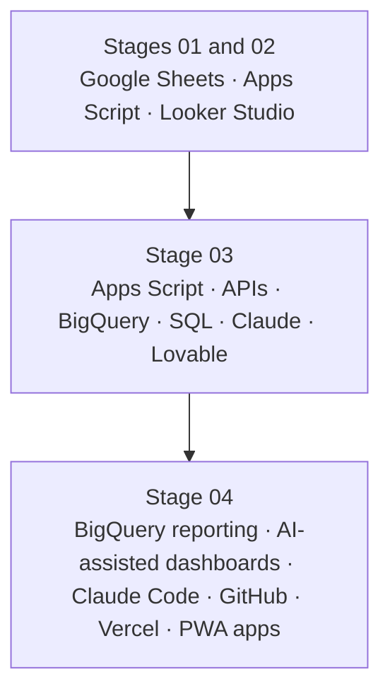
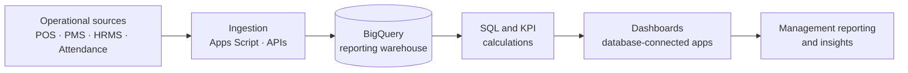

 

**Hyderabad, India** &nbsp;|&nbsp; Data Analyst at Skyla Hospitality

 

 

## About

I joined Skyla Hospitality as one of its first two Data Analysts, when there was no analytics function, KPI framework or structured reporting. Together with a senior colleague I helped establish it. I then took ownership of reporting across twelve departments, moved spreadsheet-based reporting onto a **BigQuery** warehouse with automated ingestion, developed database-connected dashboards, and built internal applications that improved operations across six properties.

---

## Core Skills and Tools

| Area | Tools and methods | Used for |
| :-- | :-- | :-- |
| **SQL and analytics** | SQL, joins and aggregations, subqueries, window functions, KPI calculations, data validation, trend analysis | Turning raw records into KPIs and checking that the numbers hold up |
| **Data warehousing** | Google BigQuery, reporting data models, analytical SQL | The central reporting layer behind dashboards |
| **Data automation** | Google Apps Script, APIs, full-refresh and incremental loading | Replacing manual data handling with automated source-to-warehouse ingestion |
| **Dashboards and BI** | Lovable and Claude (AI-assisted, database-connected dashboards), Looker Studio (earlier reporting) | Management reporting across departments |
| **Business applications** | Claude Code, GitHub, Vercel, Progressive Web Apps | Internal tools for operational teams |
| **Also** | Google Sheets, Excel, Google Cloud Platform | Early reporting, analysis and hosting |

Currently developing: Power BI. Currently learning: Python.

---

## My Four-Stage Journey at Skyla Hospitality

**Foundation → Ownership → Automation → Operational Transformation**

<table>
  <tr>
    <td width="90" align="center" valign="top"><h1>01</h1>Jul to Dec 2025</td>
    <td valign="top">
      <h3>Building the analytics foundation</h3>
      <b>Challenge:</b> no analytics function, KPI framework or structured reporting. 
      <b>Contribution:</b> one of the first two Data Analysts. With my senior colleague, I helped gather business data, establish KPI frameworks and structured reporting, and build the first dashboards. I worked under their guidance and grew in KPI design and dashboard development. 
      <b>Tools:</b> Google Sheets, Apps Script, Looker Studio. 
      <b>Outcome:</b> four departmental dashboards, built together: <b>F&B, Sales, Engineering, Housekeeping</b>.
    </td>
  </tr>
  <tr>
    <td width="90" align="center" valign="top"><h1>02</h1>Dec 2025 to Apr 2026</td>
    <td valign="top">
      <h3>Taking ownership and expanding</h3>
      <b>Challenge:</b> my senior colleague left, and management trusted me to continue the analytics work. 
      <b>Contribution:</b> trained and guided an intern, kept the first four departments running with my manager's guidance, and individually developed eight new departmental dashboards. 
      <b>Tools:</b> Google Sheets, Apps Script, Looker Studio. 
      <b>Outcome:</b> reporting extended to <b>HR, Finance, Branding & Marketing, Learning & Development, Attendance, Front Office, Procurement and Central Store</b>. As data grew, spreadsheets and dashboards hit performance and access limits, which led to the next stage.
    </td>
  </tr>
  <tr>
    <td width="90" align="center" valign="top"><h1>03</h1>Apr to Oct 2026</td>
    <td valign="top">
      <h3>Data warehousing and automation</h3>
      <b>Challenge:</b> spreadsheet-based reporting did not scale. 
      <b>Contribution:</b> in a two-person team, I did substantial individual work to learn and set up a BigQuery reporting warehouse, then built automated source-to-warehouse ingestion with Apps Script and APIs, using full-refresh and incremental loading. I wrote SQL reporting and KPI logic and moved dashboards from Looker Studio to AI-assisted, database-connected applications built with Claude and Lovable. 
      <b>Sources automated:</b> F&B POS, Sales PMS, HRMS and attendance data. 
      <b>Outcome:</b> see the internally tracked figures below. Also developed F&B costing reports and an F&B application (next section).
    </td>
  </tr>
  <tr>
    <td width="90" align="center" valign="top"><h1>04</h1>Oct 2026 to now</td>
    <td valign="top">
      <h3>Operational systems and process improvement</h3>
      <b>Challenge:</b> Housekeeping tracked work in about 13 separate Google Forms, which confused staff and made data hard to manage. 
      <b>Contribution:</b> developed a consolidated Housekeeping ERP, deployed across six properties. 
      <b>Direction (in progress, not completed):</b> deeper business insights, automated operational alerts, market analysis and better management decision support.
    </td>
  </tr>
</table>

**Automation maturity (internally tracked).** Overall automation maturity moved from about 0% to 68%: Sales, F&B and Attendance from 0% to 100%, and HR to about 79%. These are my own tracking figures for how much ingestion was automated. They are not independently audited and do not measure business performance.

---

## Technology Evolution

This shows how my work evolved. It does not mean every tool is used in every current workflow. Dashboards are built **with** AI assistance. They do not contain AI features.

---

## Business Applications and Operational Transformation

Internal applications I developed for operational teams, shown here in words only. No internal screenshots or data are published.

<table>
  <tr>
    <td width="50%" valign="top">
      <h3>F&B Costing, Consumption and Wastage</h3>
      <b>Problem:</b> kitchen teams needed a simple way to record consumption and wastage without complicated spreadsheets, and management needed better cost visibility.  
      <b>What I did:</b> gathered recipe and menu costing information, built costing reports with procurement, central store, F&B and management teams, and developed the application.  
      <b>Reach:</b> six properties, 30+ team members.
    </td>
    <td width="50%" valign="top">
      <h3>Housekeeping ERP</h3>
      <b>Problem:</b> about 13 separate Google Forms for room cleaning, kitchen usage, extra cleaning, pest control, audits and more.  
      <b>What I did:</b> consolidated those workflows into one standardized system.  
      <b>Reach:</b> six properties. It replaces a separate paid audit tool for the relevant functionality, which helped avoid approximately ₹1.8 lakh in subscription costs. It does not replace every feature of that product.
    </td>
  </tr>
</table>

Both applications were built with Claude Code and deployed through GitHub and Vercel as Progressive Web Apps, installable on mobile and desktop.

---

## Featured Public BI Projects

Public portfolio demonstrations built separately from my work applications. They use demonstration or sanitized data and do not show real company performance.

<table>
  <tr>
    <td width="50%" valign="top">
      <h3>Sales & Revenue Intelligence</h3>
      Revenue vs target, occupancy, ADR, RevPAR, bookings and room nights, lead tracking, OTA performance and report exports.  
      <a href="https://github.com/Nandini-Boda/Hospitality-Sales-Revenue-Intelligence-Platform">Repository</a>
    </td>
    <td width="50%" valign="top">
      <h3>Weekly Insight Hub</h3>
      Weekly management reporting across Revenue, Brand, People, Property and an Executive Review, using BigQuery reporting demo tables.  
      <a href="https://github.com/Nandini-Boda/hospitality-weekly-insight-hub">Repository</a>
    </td>
  </tr>
  <tr>
    <td width="50%" valign="top">
      <h3>Brand Experience HQ</h3>
      Ratings, sentiment trends, property comparison, recurring themes and review-linked action tracking. <i>Fictional demo data; no live review-platform integrations.</i>  
      <a href="https://github.com/Nandini-Boda/Brand-Experience-HQ">Repository</a> &nbsp;·&nbsp; <a href="https://stay-sentiment-compass.lovable.app/">Live demo</a>
    </td>
    <td width="50%" valign="top">
      <h3>Workforce Attendance Intelligence</h3>
      Attendance rate, department comparison, working hours, trends and employee drill-down. BigQuery data with scheduled batch sync, not real-time.  
      <a href="https://github.com/Nandini-Boda/Workforce-Attendance-Intelligence-Dashboard">Repository</a> &nbsp;·&nbsp; <a href="https://hr-attendance-dashboard.lovable.app/">Live demo</a>
    </td>
  </tr>
</table>

---

## Data Automation Workflow

Loading uses **full refresh** or **incremental loading**, depending on the source, and runs as batch updates, not real-time streaming.

---

## SQL Practice

Older practice projects, kept as supporting work.

| Project | Demonstrates |
| :-- | :-- |
| [Orders & Customers Analysis](https://github.com/Nandini-Boda/SQL-Orders-Customers-Analysis) | Joins, HAVING, a subquery, a window function and a view |
| [Bank Loan Analysis](https://github.com/Nandini-Boda/BANK-LOAN-ANALYSIS) | Month-to-date vs prior-month-to-date KPI queries |
| [Online Sales Data](https://github.com/Nandini-Boda/SQL-ONLINE-SALES-DATA) | Monthly revenue and order analysis with date functions |

---

## Education and Training

**Data Analyst Intern, Elevate Labs** (June to July 2025): Best Performer recognition.

- **B.Tech, Electronics and Communication Engineering**, RGUKT Basara, 2021 to 2025 (CGPA 8.0)
- **Data Analysis, Power BI, SQL and Excel**, United Way Hyderabad, 2025
- **Microsoft Techsaksham**, 2024

---

  

**Open to Data Analyst and BI Analyst roles** &nbsp;·&nbsp; [LinkedIn](https://www.linkedin.com/in/nandini-boda-24414a367/) &nbsp;·&nbsp; [Portfolio](https://boda-nandini-portfolio.lovable.app/)

